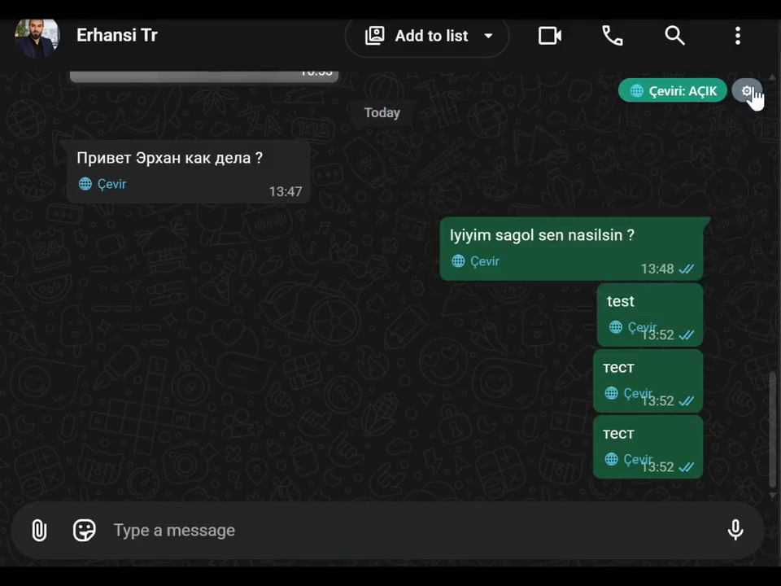

# 🌐 WhatsApp Translator (Chrome extension)

[Türkçe](README.md) · **English** · [Русский](README.ru.md)

A **completely free** translation extension for web.whatsapp.com. It translates incoming messages right inside the chat, and translates what you type into the other person's language before you send it.

> **Free.** No paid tier, no subscription, no account, no server of ours. Add your own API key for better translations; without a key it runs on Chrome's on-device translation (see [Which engine should I use?](#which-engine-should-i-use)).

## Demo video

▶ [Watch the video (65 s, with sound)](https://github.com/erhancode/whatsapp-ceviri/blob/main/docs/demo.mp4) · [docs/demo.mp4](docs/demo.mp4)

## What it does

- **Incoming messages:** every foreign-language message gets a small **🌐 Translate** link. Click it and the translation appears right below the original. With *auto-translate* on, the last ~15 messages are translated automatically. The page is never reloaded and the original message is never modified.
- **Outgoing messages:** type in your language → press Enter (or Send) → a **preview** opens: edit the translation, switch the language, or send the original. On confirm, the message goes out in the other person's language.
- **The other person's language** is learned from incoming messages in that chat; you can also pick it manually.
- Per-chat **🌐 Translation: ON/OFF** toggle, dark theme support, 25-language UI.

## Which engine should I use?

| | Chrome built-in translation | AI model (with API key) |
|---|---|---|
| Setup | None, works out of the box | URL + API key in settings |
| Cost | Free | Depends on the provider (many offer a free quota) |
| Quality | Acceptable; can be flat or robotic with idioms, tone and slang | **Clearly better**: keeps tone, politeness level, emojis, names and line breaks |
| Privacy | Text never leaves your device | Text goes only to the endpoint you entered |

In short: **Chrome's translation is not always good.** It is fine for short everyday messages; for business chats, formal writing or anything where nuance matters, add an API key. Any OpenAI-compatible provider works (9router, OpenRouter, Groq, LM Studio, Ollama, …); with several models configured they are tried in order, primary first, then fallbacks.

## Installation

The extension is **not published on the Chrome Web Store**, so there is no one-click "Add" button. Setup takes about a minute:

1. Download this repo: **Code → Download ZIP** (or `git clone https://github.com/erhancode/whatsapp-ceviri.git`).
2. Extract the ZIP into a folder.
3. In Chrome open `chrome://extensions`, enable **Developer mode** (top right), click **Load unpacked**, and select the extracted folder (the one containing `manifest.json`).
4. On the settings page that opens, choose your language. Optionally add an AI model → *Test* → *Save*. **You must enter your own API key** — no key is bundled in the code.
5. Reload the WhatsApp Web tab with **F5**.

Requires Chrome **138+** for the built-in translation API. If you only use the AI engine, older versions work too.

### Can it be installed as a package?

- **As a `.crx` file:** Chrome blocks `.crx` files from outside the Web Store for security reasons (only allowed via enterprise policy). Not recommended.
- **As a ZIP/folder (this repo):** step 3 above — this is the practical route. To update, extract the new ZIP over the same folder and hit ↻ on `chrome://extensions`.
- **Chrome Web Store:** not published. Publishing requires a developer account and a one-time fee.

## Settings

- **My language:** the language incoming messages are translated into.
- **Engine:** AI with Chrome fallback / AI only / Chrome only.
- **Auto-translate:** translate incoming messages without clicking.
- **Translate outgoing messages:** show the preview window.
- **Enter behaviour:** if WhatsApp is set to "Enter = new line", untick the matching box; the preview then opens with **Ctrl+Enter**.
- The ⚙ panel at the top right of a chat applies the same settings per chat.

## Privacy

The extension has no server, no analytics and no tracking. Message text goes only to the AI endpoints you configure; with Chrome's built-in translation the text never leaves your device. All settings live in `chrome.storage.local` on your machine.

## Files

| File | Purpose |
|---|---|
| `manifest.json` | Manifest V3 definition and permissions |
| `wa-translate.js` | Page UI: translate buttons, preview, per-chat settings |
| `background.js` | Service worker: message routing, fallback real keyboard input (CDP) |
| `translate-bg.js` | AI provider calls and prompt handling |
| `options.html/css/js` | Settings page |

No build step, no `package.json`, no dependencies — plain JavaScript.

## Known limitations

- Text insertion and message detection depend on WhatsApp's page structure and can break with WhatsApp updates. The **Diagnostics** line at the bottom of the ⚙ panel shows what is being found.
- The fallback input path may briefly show Chrome's "debugging" banner.
- Quoted-message previews are not translated.

## Contributing

Open an [Issue](https://github.com/erhancode/whatsapp-ceviri/issues) for bugs and ideas. After a change, reload the extension with ↻ on `chrome://extensions`.

## License

MIT — see [LICENSE](LICENSE).
