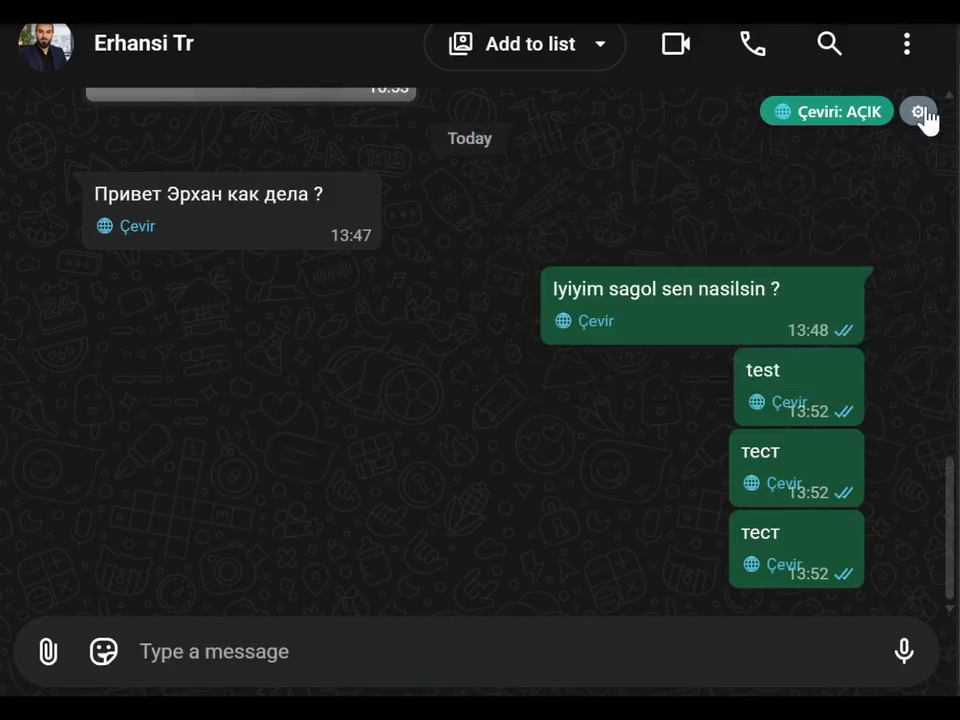

# 🌐 WhatsApp Çevirmen (Chrome uzantısı)

**Türkçe** · [English](README.en.md) · [Русский](README.ru.md)

web.whatsapp.com üzerinde çalışan, **tamamen ücretsiz** bir çeviri uzantısı. Gelen mesajları mesajın içinde çevirir; sen yazdığın mesajı göndermeden önce karşı tarafın diline çevirip gösterir.

> **Ücretsiz.** Ücretli sürüm, abonelik, hesap veya kendi sunucumuz yok. Kendi API anahtarını eklersen daha iyi çeviri alırsın; anahtar eklemezsen Chrome'un cihaz içi çevirisiyle çalışır (bkz. [Hangi motoru seçmeliyim?](#hangi-motoru-seçmeliyim)).

## Tanıtım videosu

▶ [Videoyu izle (65 sn, sesli)](https://github.com/erhancode/whatsapp-ceviri/blob/main/docs/demo.mp4) · [docs/demo.mp4](docs/demo.mp4)

## Ne yapar

- **Gelen mesaj:** Yabancı dildeki mesajın altında **🌐 Çevir** bağlantısı çıkar; tıklayınca çeviri orijinalin hemen altında görünür. *Otomatik çevir* açıksa son ~15 mesaj kendiliğinden çevrilir. Sayfa yenilenmez, mesajın kendisi değiştirilmez.
- **Giden mesaj:** Türkçe yaz → Enter (ya da Gönder) → **önizleme** açılır: çeviriyi düzenleyebilir, dili değiştirebilir, orijinali gönderebilirsin. Onaylayınca mesaj karşı tarafın diliyle gider.
- **Karşı tarafın dili** o sohbetteki gelen mesajlardan öğrenilir; istersen listeden elle seçersin.
- Sohbet bazlı **🌐 Çeviri: AÇIK/KAPALI** düğmesi, karanlık tema desteği, 25 dil arayüzü.

## Hangi motoru seçmeliyim?

| | Chrome dahili çevirisi | AI modeli (API anahtarı ile) |
|---|---|---|
| Kurulum | Yok, hazır | Ayarlardan URL + API anahtarı |
| Ücret | Ücretsiz | Model sağlayıcına göre (birçoğu ücretsiz kota verir) |
| Kalite | İdare eder; deyim, ton ve kısaltmalarda düz/robotik çeviri yapabilir | **Belirgin şekilde daha iyi**: ton, kibarlık düzeyi, emoji, isim ve satır sonları korunur |
| Gizlilik | Metin cihazdan çıkmaz | Metin yalnızca senin girdiğin adrese gider |

Kısaca: **Chrome çevirisi her zaman düzgün çeviri yapmaz.** Günlük kısa mesajlar için yeterli olabilir; iş görüşmeleri, resmî yazışmalar veya nüans gerektiren sohbetler için bir API anahtarı eklemeni öneririz. OpenAI uyumlu her sağlayıcı çalışır (9router, OpenRouter, Groq, LM Studio, Ollama vb.); birden fazla model eklersen sırayla ana → yedek olarak denenir.

## Kurulum

Uzantı **Chrome Web Store'da yayınlanmadı**; bu yüzden tek tıkla "Ekle" düğmesi yok. Kurulum 1 dakika sürer:

1. Bu depoyu indir: **Code → Download ZIP** (ya da `git clone https://github.com/erhancode/whatsapp-ceviri.git`).
2. ZIP'i bir klasöre çıkart.
3. Chrome'da `chrome://extensions` → sağ üstten **Geliştirici modu**nu aç → **Paketlenmemiş öğe yükle** → çıkardığın klasörü seç (`manifest.json` dosyasının olduğu klasör).
4. Açılan ayar sayfasında dilini seç. İstersen AI modelini ekle → *Test et* → *Kaydet*. **API anahtarını kendin girmelisin**; kodda gömülü anahtar yoktur.
5. WhatsApp Web sekmesini **F5** ile yenile.

Gereken Chrome sürümü: **138+** (cihaz içi çeviri API'si için). Yalnızca AI motorunu kullanacaksan daha eski sürümler de çalışır.

### "Paket olarak" kurulabilir mi?

- **`.crx` dosyası ile:** Chrome, Web Store dışından gelen `.crx` dosyalarını güvenlik nedeniyle engeller (yalnızca kurumsal ilke ile izin verilir). Bu yolu önermiyoruz.
- **ZIP/klasör ile (bu depo):** Yukarıdaki 3. adım — pratikte kullanılan yol budur. Güncelleme için yeni ZIP'i aynı klasöre çıkartıp `chrome://extensions` → ↻ tuşuna bas.
- **Chrome Web Store:** Yayınlanmadı. Yayın için geliştirici hesabı ve tek seferlik ücret gerekir.

## Ayarlar

- **Benim dilim:** Gelen mesajların çevrileceği dil.
- **Çeviri motoru:** AI + yedek olarak Chrome / yalnızca AI / yalnızca Chrome.
- **Otomatik çevir:** Gelen mesajlar düğmeye basmadan çevrilsin.
- **Giden mesajı çevir:** Önizleme penceresi açılsın.
- **Enter davranışı:** WhatsApp'ta "Enter = yeni satır" seçiliyse ilgili kutuyu kapat; önizleme o zaman **Ctrl+Enter** ile açılır.
- Sohbetin sağ üstündeki ⚙ paneli aynı ayarları sohbet bazında uygular.

## Gizlilik

Uzantının kendi sunucusu, analitiği veya izlemesi yoktur. Mesaj metni yalnızca ayarlarda girdiğin AI adreslerine gider; Chrome dahili çeviri seçiliyse metin cihazdan çıkmaz. Tüm ayarlar `chrome.storage.local` içinde, cihazında durur.

## Dosyalar

| Dosya | Görev |
|---|---|
| `manifest.json` | Manifest V3 tanımı, izinler |
| `wa-translate.js` | Sayfa arayüzü: çeviri düğmeleri, önizleme, sohbet bazlı ayarlar |
| `background.js` | Servis çalışanı: mesaj yönlendirme, yedek gerçek klavye girdisi (CDP) |
| `translate-bg.js` | AI sağlayıcı çağrısı ve istem (prompt) yönetimi |
| `options.html/css/js` | Ayarlar sayfası |

Derleme adımı, `package.json` veya bağımlılık yok — düz JavaScript. Tanıtım videosu: `docs/demo.mp4`.

## Bilinen sınırlar

- Metin yerleştirme ve mesaj bulma WhatsApp'ın sayfa yapısına bağlıdır; WhatsApp güncellemeleriyle bozulabilir. ⚙ panelinin altındaki **Teşhis** satırı neyin bulunduğunu gösterir.
- Yedek giriş yolu, Chrome'un "hata ayıklama" şeridini kısa süre gösterebilir.
- Alıntılanan mesaj önizlemeleri çevrilmez.

## Katkı

Hata bildirimi ve öneriler için [Issue](https://github.com/erhancode/whatsapp-ceviri/issues) açabilirsin. Değişiklikten sonra `chrome://extensions` → ↻ ile uzantıyı yeniden yükle.

## Lisans

MIT — bkz. [LICENSE](LICENSE).
